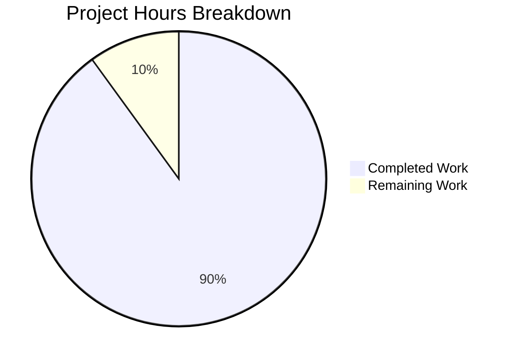

# 1. Executive Summary

## 1.1 Project Overview

A dependency-free Node.js console program: two files at the repository root, `index.js` and `README.md`, which writes `Welcome to Blitzy` plus one line feed to stdout and exits 0. A developer runs it as `node index.js` from the repository root, or an automated check consumes its stdout. Its value is exactness: a byte-identical, formatting-free payload with no dependency, manifest, build step, configuration, state or failure path. Technical scope: plain CommonJS JavaScript on Node.js 18 or later.

## 1.2 Completion Status

**90% complete — 9.0 hours of 10.0.**



Completed work is Dark Blue (#5B39F3); remaining work, White (#FFFFFF).

| Metric | Hours |
|---|---|
| Total Hours | 10.0 |
| Completed Hours (AI + Manual) | 9.0 |
| Remaining Hours | 1.0 |

AAP-scoped, hours-based: 9.0 ÷ (9.0 + 1.0) × 100 = **90%**.

## 1.3 Key Accomplishments

- `node index.js` writes exactly 18 bytes — `Welcome to Blitzy` plus one LF — to stdout, and exits 0.
- `index.js` is exactly the two specified lines: a JSDoc summary, then the print statement.
- `README.md` states the Node.js requirement and the run command in four lines.
- The repository holds only those two files — no manifest, lockfile, dependency, test file or configuration — and the program runs with nothing installed.
- Output is byte-identical across runs, concurrency, locales, environments and every consumer sink tried.
- A run leaves no trace: tree, hashes and version-control state are unchanged.
- Arguments and standard input are ignored without blocking, and piped writes arrive intact.

## 1.4 Critical Unresolved Issues

Five items remain open across four of the twenty-seven scoped requirements; none blocks release.

| Issue | Impact | Owner | ETA |
|---|---|---|---|
| The stated floor's lowest line (Node.js 18.x, itself end-of-life) was never executed — only v22.23.3 is installed here. | Low | Developer / QA | Next verification pass |
| Nothing declares or enforces the runtime floor: no manifest or version guard may exist, so an older interpreter fails with the runtime's own error and no program-side diagnostic. | Low | Developer | Accepted as designed |
| No automated regression guard exists — a future edit to the payload literal is caught only by running the byte gate by hand. | Medium | Developer | Standing practice |
| Behaviour under deliberate failure conditions (stdout closed mid-write, full-disk sink, missing interpreter) has never been exercised; the program adds no failure handling by design. | Low | Developer | Accepted as designed |
| `README.md` lines 3 and 4 form one paragraph in some Markdown renderers (soft break). | Low | Developer | Next documentation touch |

## 1.5 Access Issues

No access issues identified: the project needs no credential, service, database, port or third-party access.

## 1.6 Recommended Next Steps

1. [High] Adopt the documented gate — `node --check index.js && node index.js | xxd && node index.js > /dev/null; echo $?` — as the release check.
2. [Medium] Run the program once on an actual Node.js 18.x interpreter and confirm the same 18 bytes and exit 0 (0.5 h).
3. [Low] Decide at the next specification revision whether to raise the floor above the end-of-life 18.x line (0.5 h).
4. [Low] Confirm the README renders acceptably in your documentation toolchain.
5. [Low] Tell consumers input is ignored, so piping a large stream in makes the producer see `Broken pipe`.

# 2. Project Hours Breakdown

## 2.1 Completed Work Detail

Every hour below is AAP-scoped: a deliverable the specification names, or verification of one of its functional and non-functional requirements.

| Component | Hours | Description |
|---|---|---|
| Program implementation — `index.js` | 1.0 | The byte-exact 18-byte stdout write, the two-line shape, plain CommonJS with no semicolon, no exit call, no input read and no failure path. |
| Documentation — `README.md` | 0.5 | The four fixed lines: heading, the Node.js 18-or-later requirement, and the run command `node index.js`, within the five-line cap. |
| Repository shape and absence properties | 0.5 | Two-file tree; no manifest, lockfile, dependency, test file or configuration; the smallest possible diff; the pre-existing documentation path rewritten in place rather than recreated. |
| Output-contract verification | 2.5 | Byte dump against the specified 18 bytes, exit status across direct, piped and shell-wrapped invocations, stdout-only with empty stderr, arguments and standard input ignored, natural termination with an intact piped write. |
| Portability, determinism and zero-footprint confirmation | 2.5 | Repeated and concurrent runs collapsing to one hash, locale and environment variation, sink independence, dependency-free and permission-restricted invocation, and unchanged tree, hashes and version-control state after running. |
| Static conformance and syntax gate | 1.0 | `node --check`, byte-identity of both files against the specification, token and absence sweeps, and security-class sweeps over the two files. |
| Adversarial and boundary verification | 1.0 | Argument-length and descriptor-limit boundaries, hostile working-directory and module-resolution controls, read-only and deep working directories, alternative shells. |
| **Total** | **9.0** | |

## 2.2 Remaining Work Detail

| Category | Hours | Priority |
|---|---|---|
| Cross-version validation on the stated floor's lowest line (Node.js 18.x) | 0.5 | Medium |
| Runtime-floor documentation review — decide at the next specification revision whether to raise the floor above the end-of-life 18.x line | 0.5 | Low |
| **Total** | **1.0** | |

## 2.3 Calculation

Completed 9.0 hours + Remaining 1.0 hour = **10.0 total project hours**. AAP-scoped completion = (9.0 ÷ 10.0) × 100 = **90%**. The remaining hour is release-confirmation work; no scoped deliverable is unimplemented. The same numbers appear in Sections 1.2, 2.1, 2.2, 7 and 8.

# 3. Test Results

**532 runtime checks were executed against the delivered program, and all 532 passed with none failing.** The rows below group those checks by the capability each exercised, so several capabilities appear in more than one sweep. No coverage percentage is given anywhere in this guide: the repository may not carry a manifest, test file or coverage tool, so statement coverage is not measurable and the guard is behavioural. The whole-package gate was re-run at the current revision and passes.

| Area / Category | Framework | Tests | Passed | Failed | Coverage | What This Proves |
|---|---|---|---|---|---|---|
| Output payload and stream contract | Node.js v22.23.3 — shell harness, no test framework present or permitted | 56 | 56 | 0 | Not measurable | Every run emits exactly the 18 specified bytes on stdout, formatting-free, with an empty stderr and exit status 0. |
| Command-line argument surface | Node.js v22.23.3 — shell harness | 28 forms | 28 | 0 | Not measurable | No argument is read: option-like, hostile, oversized and multi-thousand-argument invocations all yield the same 18 bytes and exit 0, with no help or usage surface. |
| Standard input | Node.js v22.23.3 — shell harness | 11 cases | 11 | 0 | Not measurable | Standard input is never read or awaited — held-open, closed and multi-megabyte streams are ignored without blocking, and piped bytes are left unconsumed. |
| Determinism, idempotency and sink independence | Node.js v22.23.3 — shell harness | 20 sequential runs, 200-run scale check, 20 parallel runs, 8 locale values, 7 sink kinds | all identical, 0 divergent | 0 | Not measurable | Output is a constant: repeated, parallel and locale-varying runs, and every consumer sink (pipe, file, FIFO, pty, command substitution), produce one identical byte sequence. |
| End-to-end acceptance and adversarial sweep | Node.js v22.23.3 — shell harness | 224 cases | 224 | 0 | Not measurable | Boundary-length arguments, hostile environments, foreign and read-only working directories, dependency hijack controls and a deny-all permission run all hold the contract. |
| Whole-package gate | `node --check` plus the documented byte and exit checks | 1 | 1 | 0 | Not measurable | The script parses as plain CommonJS with no module, loader or experimental warning, and the documented gate passes end to end at exit 0. |

**Not Covered — what no test exercised, and what a human should check before release:**

- **Any Node.js release other than v22.23.3.** The stated floor is "18 or later" and the runtime here satisfies it, but no 18.x interpreter exists to execute, so the floor's lowest line is untested. Run `node index.js | xxd` and the exit-status check once on an 18.x interpreter before depending on that line.
- **Deliberate failure conditions.** A stdout stream closed mid-write, a full-disk sink, and a missing or older interpreter were never exercised, because the program deliberately carries no failure handling and adds none. If a consumer depends on the exit status, confirm its behaviour under an unwritable or closed output stream operationally.
- **Syscall-level footprint proof.** No tracing tool is available, so the absence of side effects rests on tree, content-hash and version-control snapshots taken around the runs, plus a deny-all permission run, rather than on a syscall trace.
- **Locales other than the three installed.** Only `C`, `C.utf8` and `POSIX` exist here; the payload is pure ASCII with no escape sequence, so no locale can alter it, but an installed non-ASCII locale was not exercised.
- **No user interface, page or outbound integration exists**, so no browser flow, screenshot, accessibility or network-integration check applies. There is nothing of that kind to test.

# 4. Runtime Validation & UI Verification

Runtime validation was performed by executing the program on Node.js v22.23.3 and capturing its byte streams and exit statuses — the only observables this product has. Every line below was driven and observed.

- ✅ **Invocation from the repository root** — `node index.js` prints `Welcome to Blitzy` and returns.
- ✅ **Output payload, formatting and stream discipline** — `xxd`, `od -c` and `hexdump -C` show exactly the 18 specified bytes on stdout with a single LF and no escape, carriage-return, tab or BOM byte; `cmp` against an independent `printf` reference is identical; stderr stays empty, including under a terminal sink with colour variables set.
- ✅ **Exit status** — 0 directly, through a pipe, through `sh -c`, `bash --posix -c` and under an empty environment.
- ✅ **Argument surface** — 27–28 forms including option-like, shell-metacharacter, Unicode and boundary-length arguments: identical bytes every time, with no usage text and no error.
- ✅ **Standard input** — ignored and non-blocking: a FIFO held open by a live writer returns in about 105 ms, and piped bytes are provably left unconsumed for a later reader.
- ✅ **Consumer delivery and termination** — a five-hop pipe chain, a reader attaching two seconds late and a FIFO read by another process all receive all 18 bytes with status 0.
- ✅ **Determinism and idempotency** — 200+ runs, 20 concurrent runs and 8 locale values collapse to one hash; repeated and parallel execution leaves a single payload and no residue.
- ✅ **Zero run-time footprint** — tree, content hashes, version-control status and the host compile cache are unchanged after the battery, with no residual process, zombie or core file.
- ✅ **Dependency-free invocation** — runs with nothing installed, under `env -i`, under a deny-all permission model, from foreign, deep and read-only working directories, with module-resolution hijack attempts proven ineffective.
- ⚠ **Runtime floor breadth** — verified on Node.js v22.23.3, which satisfies the stated "18 or later"; no 18.x interpreter exists on this host, so the floor's lowest line remains unexecuted.

**Never exercised at runtime:** deliberate failure conditions (a stdout stream closed mid-write, a full-disk sink, a missing or older interpreter), any Node.js release other than v22.23.3, and syscall-level tracing of the program's footprint. There is no user interface, no page and no outbound request in this product, so no screen, flow or integration of that kind exists to drive and no browser evidence applies.

# 5. Compliance & Quality Review

## 5.1 Compliance Matrix

Every deliverable below is shown in the state it stands in now, verified against the specification's own wording.

| # | Deliverable | Benchmark | Status | Progress | Evidence |
|---|---|---|---|---|---|
| 1 | Byte-exact output contract | Success criterion 1: exactly `Welcome to Blitzy` + one LF (18 bytes), exit 0 | ✅ PASS | 100% | `node index.js \| xxd` reproduces the specified dump; `wc -c` 18; `cmp` against an independent reference identical; exit 0 in every wrapper tested |
| 2 | Two-line program shape and token economy | Specification 0.5.1: one-line JSDoc summary plus the print statement, fewest tokens | ✅ PASS | 100% | `index.js` is 2 lines / 94 bytes; no semicolon, escape, module syntax, exit call or second statement |
| 3 | Documentation content and line cap | Success criterion 3: under five lines carrying the Node.js requirement and the run command | ✅ PASS | 100% | `README.md` is 4 lines / 76 bytes, byte-identical to the fixed text; the command resolves to the existing root file |
| 4 | Repository shape | Success criterion 3: only `index.js` and `README.md` plus version-control metadata | ✅ PASS | 100% | `git ls-files` and a filesystem scan both list exactly those two files; 0 untracked files |
| 5 | Zero dependencies | Success criterion 4: no `package.json` dependency, lockfile or test file | ✅ PASS | 100% | Every manifest, lockfile, `node_modules`, test and config path absent, including in ancestor directories; runs under an empty environment |
| 6 | Scope boundary | Specification 0.7.2: no packaging, deployment, logging, configuration, localisation or extra file | ✅ PASS | 100% | 0 hits for every excluded artifact class; tree holds two files |
| 7 | Non-functional requirements | Specification 0.1.1: determinism, portability, zero run-time footprint | ✅ PASS | 100% | 200+ runs, 8 locale values, 7 sink kinds and 20 concurrent runs collapse to one hash; tree, hashes and version-control state unchanged after running |
| 8 | Input and failure surface | Specification 0.1.1/0.7.2: input ignored, no failure path, no unrequested hardening | ✅ PASS | 100% | 27–28 argument forms and 10–11 stdin forms ignored without blocking; 0 bytes on stderr; no try/catch, version guard or diagnostic call |
| 9 | Documentation accuracy | Every README claim holds against the code | ✅ PASS | 100% | The documented command names the file that exists; the stated floor is satisfied by the code's language level and by the runtime in use |
| 10 | Security posture | No secret, input, injection, network or filesystem surface | ✅ PASS | 100% | Sweeps for credential, input, injection and capability classes return nothing; the emitted bytes are a fixed ASCII constant with no escape byte |
| 11 | Code quality and change discipline | No dead code, stub or placeholder; smallest possible diff with no refactor or rename | ✅ PASS | 100% | Zero marker hits and one mandated comment; the diff is `A index.js` plus `M README.md`, 6 insertions and 2 deletions, nothing renamed |
| 12 | Runtime floor recorded once | Specification 0.3.1/0.6.2: the floor stated in the README, since no manifest may exist | ⚠️ PASS WITH CAVEAT | 100% of scope | `README.md:3` states it exactly and no manifest duplicates it; the lowest line (18.x) was not executable here and nothing enforces the floor |

## 5.2 AAP & Rule Divergences and Gaps

One class of divergence is possible for this project: departures from the specification. The user's rules document is empty, so no rule was superseded or broken; nothing here is a defect — each row is a settled decision that a higher-ranked source required, and none blocks release.

| # | What the AAP / Rule Required | What Was Delivered Instead | Why It Diverged | Impact | Remediation |
|---|---|---|---|---|---|
| D1 | Plan 0.8.1: both files created, "the checkout is empty and neither path exists" | `index.js` created; `README.md` rewritten in place over a pre-existing tracked 36-byte scaffold — `M README.md` beside `A index.js` | The path already existed at the baseline commit, and recreating it would have added a delete and an add to a diff the specification requires to be the smallest possible | None on behaviour: the delivered content is byte-exact | None — read the change set as a modification plus an addition; do not "correct" the file to match an action label |
| D2 | The repository's usual convention would declare the runtime floor in a manifest (`engines` or an equivalent) | The floor lives only in `README.md:3`; no manifest, `engines` field or version guard exists | Success criteria 3–4 make any manifest, lockfile or dependency a forbidden artifact, and the specification assigns the floor to the README | Nothing declares or enforces the floor; an older interpreter fails with the runtime's own error and no program-side message | None in code. State the floor in consumer or deployment notes and validate on 18.x (0.5 h, Section 2.2) |
| D3 | Standing rule: run the repository's linter in check mode | No repository linter was run; an external read-only Markdown linter in check mode plus a whitespace check over the diff returned 0 errors and 0 whitespace violations | The repository declares no linter and none may be added, since its configuration would be a forbidden artifact | None — a read-only equivalent check was performed | None |
| D4 | Standing convention: annotate code with the decision that produced it | Neither file carries a rationale comment; `index.js` holds only the one mandated JSDoc line | `index.js` is fixed at two lines and `README.md` at four under a five-line cap, so any added comment would break the deliverable | The reasoning behind natural termination and the README-only floor is not visible inside the files | None — keep that reasoning in the change history or issue tracker |
| D5 | The request fixes the runtime floor as "current LTS (18 or later)" | `README.md:3` states "Requires Node.js 18 or later" with no note that 18.x reached end-of-life on 2025-04-30 | The floor is the request's own value and the wording is fixed; the five-line cap leaves no room for a note | Documentation currency: a consumer may run an unsupported line | Raise the floor at the next specification revision (0.5 h, Section 2.2) |
| D6 | Plan 0.8.2: one change creating both files together, with no intermediate state | Two commits — `index.js` first, then `README.md` — so the history briefly holds the program beside the scaffold documentation | The two files were written as separate units of work; commit granularity is not a deliverable property | None — the final tree is complete on both paths | None |
| D7 | Specification 0.1.2/0.7.2: verification is the four success criteria, and no verification artifact may enter the repository | Verification was extended with ad-hoc assertions and boundary cases; every artifact stayed outside the repository and was discarded | Broader confirmation of the same criteria, chosen so that the repository bound was honoured exactly | None on the deliverable | None — keep verification artifacts outside the repository and use the documented gate as the repeatable check |

**D1 — the documentation path was already occupied.** The plan assumed an empty checkout, but the baseline commit tracked a two-line scaffold at `README.md` (`# asdasd-511d0ab5` / `Created by Blitzy`). The work replaced it in place, which `git diff --name-status 8e2b103` confirms as `M README.md` beside `A index.js`; the four specified lines are byte-identical to the specification, and the scaffold text appears nowhere in the working tree or in either delivered file. Deleting and recreating the path would have enlarged the diff the specification requires to be minimal and would have passed through a state with no documentation at all. Nothing needs doing: read the change set as a modification plus an addition, and do not rewrite the file to satisfy an action label.

**D2 — the runtime floor is documented rather than declared.** The floor could not be expressed where such things usually live, because no manifest, lockfile or dependency may exist in this repository; the specification therefore places it in `README.md:3`, and that line is the only place it appears anywhere in the tree. The consequence is real but small: nothing enforces the floor, and an interpreter older than 18 fails with the runtime's own error message rather than a program-side diagnostic, which is the deliberate design — the program adds no failure handling. Leave the manifest absent, and if you need the floor enforced in your own pipeline, check `node --version` there rather than changing this repository.

**D3 — the repository's linter step had no linter to run.** The standing rule is to run the repository's linter in check mode without fixing, but this repository declares no linter, formatter or style configuration, and adding one would introduce exactly the kind of file the success criteria forbid. The intent of the rule — catch style and whitespace problems without mutating the tree — was met with a read-only Markdown linter in check mode and a whitespace check over the diff; both returned zero errors and zero whitespace violations, and neither left a file behind. There is nothing to change, and a future maintainer should not add linting configuration to satisfy the rule.

**D4 — no rationale comments in either file.** The convention of annotating code with the decision that produced it was not followed, because the files have no room for it: `index.js` is fixed at exactly two lines and `README.md` at four under a five-line cap, so any added comment would break success criterion 2 or 3. The design decisions that would otherwise be annotated — natural termination instead of an explicit exit call, so a piped write cannot be truncated, and the README as the only record of the runtime floor — are instead visible from the code's shape and from this guide. Record future rationale in the change history or issue tracker rather than in the files.

**D5 — the stated floor includes a line the runtime has retired.** `README.md:3` reads "Requires Node.js 18 or later" because that is the request's own floor and the wording is fixed; Node.js 18.x reached end-of-life on 2025-04-30, and the four-line limit leaves no space for a note about it. The claim is accurate as written — every Node.js 18 or later release runs the two lines unchanged, since the program uses one call expression, a string literal and the `console` global, which has existed since v0.1.100 — but a consumer could reasonably act on the older end of it. Raise the floor when the specification is next revised, which is the 0.5-hour item in Section 2.2.

**D6 — the delivery landed as two commits rather than one pass.** The plan describes a single change creating both files together with no intermediate state; in practice `index.js` was committed first and `README.md` second, so the history contains a point at which the program sat beside the scaffold documentation. The final tree is complete on both paths: the program is byte-exact, the documentation is byte-exact, and no third path was touched, renamed or deleted. Commit granularity is not a property the deliverable is judged on, so no action follows — simply read the intermediate commit as work in progress rather than as a partial deliverable.

**D7 — verification went beyond the four criteria, outside the repository.** The specification bounds verification to the four success criteria and forbids any evidence artifact inside the repository. The program was additionally put through argument-length and descriptor boundaries, hostile environment and working-directory controls, and module-resolution hijack attempts; every one of those artifacts was written outside the repository and discarded, so the tree still holds exactly two files and neither carries a byte of evidence. Nothing needs doing, and the same bound should be kept for future changes: verify as hard as you like, but leave the repository at its two files and use the documented gate as the repeatable check.

# 6. Risk Assessment

Risks below are forward-looking: what could still go wrong once this program is in use.

| Risk | Category | Severity | Probability | Mitigation | Status |
|---|---|---|---|---|---|
| The printed literal is the only variable in the program, and no automated test may exist to catch a change to it. | Technical | Medium | Medium | Run the documented gate — `node --check index.js && node index.js \| xxd && node index.js > /dev/null; echo $?` — before every release; treat the 18-byte dump as the contract. | Open — accepted |
| The stated floor's lowest line (Node.js 18.x) was never executed; only v22.23.3 is available here. | Technical | Low | Low | Validate once on an 18.x interpreter (0.5 h, Section 2.2); the program uses no version-dependent feature, so exposure is small. | Open |
| `README.md` lines 3 and 4 form a single paragraph in some Markdown renderers. | Technical | Low | Medium | Confirm rendering in the publishing toolchain; the four lines are fixed by the specification, so no content change is available. | Open — accepted |
| The runtime floor is unenforceable by tooling: no manifest or version guard may exist, so an older interpreter fails with the runtime's own error and no program-side diagnostic. | Operational | Low | Medium | State the floor in consumer or deployment notes and check `node --version` in the consuming pipeline. | Open — accepted |
| The stated floor includes Node.js 18.x, which reached end-of-life on 2025-04-30 and no longer receives security fixes. | Operational | Low | High (already true) | Raise the floor at the next specification revision (0.5 h, Section 2.2). | Open |
| The program has no failure handling by design: a stdout stream closed mid-write surfaces as an OS-level error with no program message. | Operational | Low | Low | Consumers should check the exit status; the absence of handling is the specification's requirement, not a gap to close. | Open — accepted |
| The runtime itself starts uncleanly in a pathological environment: Node.js v22.23.3 segfaults at start-up when `LC_ALL` holds an absurdly long value, reproducing without this program. | Operational | Low | Low | Keep the environment sane; no program-side handling is permitted, and no change to these two files can settle a runtime defect. | Open — runtime condition |
| A consumer that pipes a large stream into the program will see `Broken pipe`, because standard input is deliberately never read. | Integration | Low | Medium | Document that input is ignored and avoid piping large streams into it; the behaviour is required, and the program's own stdout and exit status remain correct. | Open — accepted |

No security risk is carried: the program has no input surface to validate, no dependency to compromise, no credential or secret, no network access and no filesystem write. Sweeps for credential, injection and dangerous-capability classes return nothing on both files, and the 18 emitted bytes are a fixed ASCII constant containing no escape byte.

# 7. Visual Project Status


Completed work is Dark Blue (#5B39F3); remaining work is White (#FFFFFF). The chart shows 9.0 completed hours and 1.0 remaining hour out of 10.0 total — the same figures as Sections 1.2 and 2.2.

| Measure | Value |
|---|---|
| Total Hours | 10.0 |
| Completed Hours | 9.0 (Dark Blue #5B39F3) |
| Remaining Hours | 1.0 (White #FFFFFF) |
| Completion | 90% |
| Open items | 5, none blocking |
| Scoped requirements unimplemented | 0 of 27 |

| Remaining Work by Category (Section 2.2) | Hours | Priority |
|---|---|---|
| Cross-version validation on the stated floor's lowest line (Node.js 18.x) | 0.5 | Medium |
| Runtime-floor documentation review at the next specification revision | 0.5 | Low |
| **Total** | **1.0** | |

# 8. Summary & Recommendations

The project delivered exactly what it set out to: a dependency-free Node.js console program of two files at the repository root whose whole behaviour is to write `Welcome to Blitzy` followed by a single line feed to standard output and exit with status 0. Both files are byte-identical to the specified content — `index.js` at two lines and 94 bytes, `README.md` at four lines and 76 bytes — and the repository holds nothing else: no manifest, lockfile, dependency, test file, configuration or build step. The program was verified by running it: 532 runtime checks were executed against it and 532 passed, with no failures in any category.

What the verification established, capability by capability, is that the output contract holds exactly (an 18-byte payload matching the specified dump byte for byte, an empty stderr and exit status 0 in every wrapper tried), that no argument or standard input is ever read or awaited, that termination is natural so a piped write arrives intact, that the output is a constant across 200+ runs, concurrency, eight locale values and every consumer sink tested, that the program runs with nothing installed and under a deny-all permission model, and that a run leaves the tree, its hashes and the version-control state untouched. The static picture agrees: both files are byte-exact against the specification, no forbidden token or artifact appears anywhere, and every security-class sweep returns nothing because the program has no input surface, no dependency, no network access and no filesystem write.

Completion stands at **90%** on an AAP-scoped, hours-based measure: 9.0 completed hours of a 10.0-hour total. Every one of the 27 scoped requirements is implemented and verified; no requirement is partially delivered or unstarted. The remaining hour is release-confirmation work rather than unfinished scope — validating the program once on the stated floor's lowest supported line, Node.js 18.x, which no interpreter on this host could execute, and deciding at the next specification revision whether to raise that floor above the end-of-life 18.x line.

| Measure | Value |
|---|---|
| Scoped requirements implemented | 27 of 27 |
| Runtime checks executed / passed | 532 / 532 |
| Completed hours / total hours | 9.0 / 10.0 |
| AAP-scoped completion | 90% |
| Remaining hours | 1.0 |
| Release-blocking items | 0 |

**Production readiness: ready for its stated purpose.** A console program that prints one line and exits 0 has no server to harden, no state to migrate, no dependency to patch and no configuration to get wrong, and this one was exercised end to end on its documented invocation, including its boundary and hostile-input behaviour. The critical path to sign-off is short: run the documented gate once on an 18.x interpreter, and keep that same gate as the release check, because no automated test may exist and the byte dump is the only guard against a change to the payload literal. The five open items in Section 1.4 are all low or medium impact and none blocks release; the two that need a decision rather than work are the runtime-floor items in Section 2.2.

The seven divergences recorded in Section 5.2 are all settled decisions that a higher-ranked source required, not defects: the documentation path was rewritten in place because it already existed, the runtime floor is documented rather than declared because no manifest may exist, the repository's absent linter was replaced with a read-only check, no rationale comments were added because the files are fixed at two and four lines, the floor keeps the request's own wording, the delivery landed as two commits rather than one pass, and verification beyond the four criteria was kept entirely outside the repository. Together they leave the deliverable exactly as specified, and a maintainer can work from the two files alone.

# 9. Development Guide

Every command below was executed from the repository root at the current revision and its output is quoted as observed. The repository root is the directory that contains `index.js` and `README.md`.

## 9.1 System Prerequisites

- **Node.js 18 or later.** Verified here on `v22.23.3`:
  ```bash
  node --version
  # v22.23.3
  ```
- **A byte dumper for verification** — `xxd` (used below), or `od`/`hexdump` as equivalents; `command -v xxd` prints the location of the one you have.
- Nothing else: no package manager step, no virtual environment, no compiler, no container, no database, no service, no credentials, and no network access. The whole project is the two files, about 1.5 KB.

## 9.2 Environment Setup

There is none. The project reads no environment variable and requires no configuration file; it produces identical output under a completely empty environment:

```bash
env -i "$(command -v node)" index.js
# Welcome to Blitzy
```

## 9.3 Dependency Installation

There is nothing to install, and installing anything into this repository would break its contract — no manifest, lockfile or dependency directory may exist:

```bash
ls package.json
# ls: cannot access 'package.json': No such file or directory
```

Do not run `npm install`, `npm init` or any equivalent. The program depends only on the Node.js runtime's `console` global.

## 9.4 Start-up Sequence

One command from the repository root, with no build, compile or preparation step:

```bash
node index.js
# Welcome to Blitzy
```

## 9.5 Verification Steps

Confirm the exact output bytes, then the exit status, then that the file parses. The whole-package gate combines all three.

```bash
# 1. Byte-exact output: must be exactly these two dump lines (18 bytes)
node index.js | xxd
# 00000000: 5765 6c63 6f6d 6520 746f 2042 6c69 747a  Welcome to Blitz
# 00000010: 790a                                     y.

# 2. Byte count, independently
node index.js | wc -c
# 18

# 3. Exit status on the success path
node index.js > /dev/null; echo $?
# 0

# 4. Confirm nothing is written to stderr
node index.js 2>&1 >/dev/null | wc -c
# 0

# 5. Syntax check — parses as a plain CommonJS script, no output on success
node --check index.js; echo $?
# 0

# 6. Whole-package gate (the documented release check)
node --check index.js && node index.js | xxd && node index.js > /dev/null; echo $?
# prints the two dump lines above, then: 0
```

Optional determinism spot check — twenty runs must collapse to one hash:

```bash
for i in $(seq 20); do node index.js | sha256sum; done | awk '{print $1}' | sort -u
# 2dc7e85a734de043468d7beb8ee5294e0c04440f23fd89b69fd8ea0ee7971951
```

## 9.6 Example Usage

Invoke it and consume its single line — the program reads nothing, so the result is identical however it is called:

```bash
node index.js                 # prints one line to the terminal
node index.js > out.txt       # 18 bytes in out.txt
node index.js | wc -c         # 18
node index.js some arguments  # arguments are ignored; same output, exit 0
```

## 9.7 Troubleshooting

| Symptom | Cause | Resolution |
|---|---|---|
| `Error: Cannot find module .../index.js` with exit status 1 | The run command is repository-root-relative, so a run from any other working directory looks for a file that is not there. | `cd` to the repository root, or pass the absolute path — `node /path/to/index.js` produces the identical 18 bytes and exit 0. |
| `node: command not found`, or the program fails before printing | Node.js is missing, or older than 18. The program deliberately adds no version check or diagnostic. | Install Node.js 18 or later and re-run the gate in 9.5. |
| A process piping a large stream into the program reports `Broken pipe` | Standard input is deliberately never read, so the program exits without draining the pipe and the producer sees the error. The program's own stdout is still 18 bytes with exit status 0. | Do not pipe large streams into it; the producer's error is not a program failure. |
| A terminal capture shows 19 bytes instead of 18 | The terminal driver translates LF to carriage-return + LF (ONLCR). The program's own output is still 18 bytes. | Redirect to a file, or disable the translation with `stty -onlcr`, and re-check. |
| `ls: cannot access 'package.json'` | Correct — the repository intentionally has no manifest. | Do not add one; install nothing. |
| The stated floor cannot be declared in the project | No manifest, `engines` field or version guard may exist. | Check `node --version` in the consuming pipeline; the floor is documented in `README.md`. |

## 9.8 What Not To Change

The specification that governs this repository fixes `index.js` at exactly two lines and `README.md` at four lines under a five-line cap. Do not add a semicolon, a second statement, an explicit exit call, version handling, configuration, logging, a manifest, a lockfile, a dependency, a test file, a linter or any other file — each would break one of the four success criteria. A change to the payload literal must be checked with the gate in 9.5, because no automated test exists to catch it.

# 10. Appendices

## A. Command Reference

All commands run from the repository root.

| Command | Purpose | Expected result |
|---|---|---|
| `node --version` | Confirm the runtime floor | `v18.x` or later (verified here on `v22.23.3`) |
| `node index.js` | Run the program | prints `Welcome to Blitzy` |
| `node index.js \| xxd` | Byte-exact output check | the 18-byte dump `5765 … 7a 790a` |
| `node index.js \| wc -c` | Byte count | `18` |
| `node index.js > /dev/null; echo $?` | Exit status | `0` |
| `node index.js 2>&1 >/dev/null \| wc -c` | Confirm stderr is empty | `0` |
| `node index.js > out.bin; cmp out.bin <(printf 'Welcome to Blitzy\n')` | Compare against a reference payload | no output — the files are identical |
| `node --check index.js` | Parse without executing | no output, exit 0 |
| `node --check index.js && node index.js \| xxd && node index.js > /dev/null; echo $?` | Whole-package gate (the documented release check) | the dump, then `0` |
| `for i in $(seq 20); do node index.js \| sha256sum; done \| awk '{print $1}' \| sort -u` | Determinism spot check | one hash, `2dc7e85a…` |
| `env -i "$(command -v node)" index.js` | Confirm no environment is required | `Welcome to Blitzy` |
| `git ls-files` | Confirm the two-file tree | `README.md`, `index.js` |
| `cat -A index.js` | Confirm line endings and shape | two LF-terminated lines, no trailing blank line |

## B. Port Reference

Not applicable. The program binds no TCP or UDP port, opens no socket and starts no service; its only interfaces are the standard output stream and the process exit status.

## C. Key File Locations

| Path | Role |
|---|---|
| `index.js` | The entire program: line 1 the one-line JSDoc summary, line 2 `console.log('Welcome to Blitzy')`. Two lines, 94 bytes. |
| `README.md` | The only documentation: heading, the Node.js 18-or-later requirement, and the run command. Four lines, 76 bytes. |
| `.git/` | Version-control metadata only; not part of the deliverable. |

No other path forms part of the deliverable. There is deliberately no `src/`, `tests/`, `docs/`, `scripts/`, `config/` or `.github/` directory, and no manifest, lockfile, container file, licence or changelog.

## D. Technology Versions

| Component | Version | Notes |
|---|---|---|
| Node.js (verified here) | v22.23.3 | Satisfies the stated floor of 18 or later; the single interpreter available |
| Node.js (minimum supported) | 18.x | The stated floor; 18.x reached end-of-life on 2025-04-30, so validate before depending on that line |
| JavaScript | ES5-level syntax | One call expression with a string literal; no feature newer than ES5 is used |
| Module system | CommonJS (implicit) | No `package.json` in any ancestor, so the `.js` file is treated as CommonJS |
| Byte dumper | `xxd` (`od`, `hexdump` equivalent) | Verification only; never added to the repository |
| Dependencies | none | No runtime dependency, development dependency, manifest or lockfile |

## E. Environment Variable Reference

| Variable | Read by the program? | Notes |
|---|---|---|
| Any variable | No | The program reads no environment variable. It produces identical output under an empty environment and under every variation tested, including `TERM`, `NO_COLOR`, `FORCE_COLOR`, `TZ`, `LANG`, `LC_ALL`, `NODE_ENV`, `NODE_OPTIONS` and `NODE_PATH`. |

## F. Developer Tools Guide

| Task | Tool | Command |
|---|---|---|
| Edit the program | any text editor | keep exactly two lines in `index.js` |
| Parse-check the file | Node.js | `node --check index.js` |
| Inspect output bytes | `xxd`, `od -c`, `hexdump -C` | `node index.js \| xxd` |
| Compare against a reference payload | `cmp` or `diff` | see Appendix A |
| Check determinism | `sha256sum`, `sort -u` | the loop in Appendix A |
| Check the tree | `git` | `git ls-files`, `git status --porcelain -uall` |

No linter, formatter, test runner, coverage tool or security scanner belongs to this repository; adding one would require a manifest or configuration file that the success criteria forbid. The documented gate is the check.

## G. Glossary

| Term | Meaning |
|---|---|
| Byte-exact | The program's output is compared as raw bytes, not as rendered text: 18 bytes, `Welcome to Blitzy` followed by one LF (0x0a). |
| LF | Line feed, byte `0x0a`; the single trailing newline comes from `console.log`, never from the literal. |
| Natural termination | The process ends by falling off the end of the script rather than by calling `process.exit`, so a piped write is never truncated and the status is 0. |
| Gate | The repeatable check `node --check index.js && node index.js \| xxd && node index.js > /dev/null; echo $?`. |
| Runtime floor | The minimum runtime the project supports: Node.js 18 or later, recorded in `README.md` because no manifest may exist. |
| Success criteria | The four acceptance conditions: the 18-byte output and exit 0; at most two lines in `index.js`; only the two files, with a README under five lines carrying the run command; and no `package.json` dependency, lockfile or test file. |
